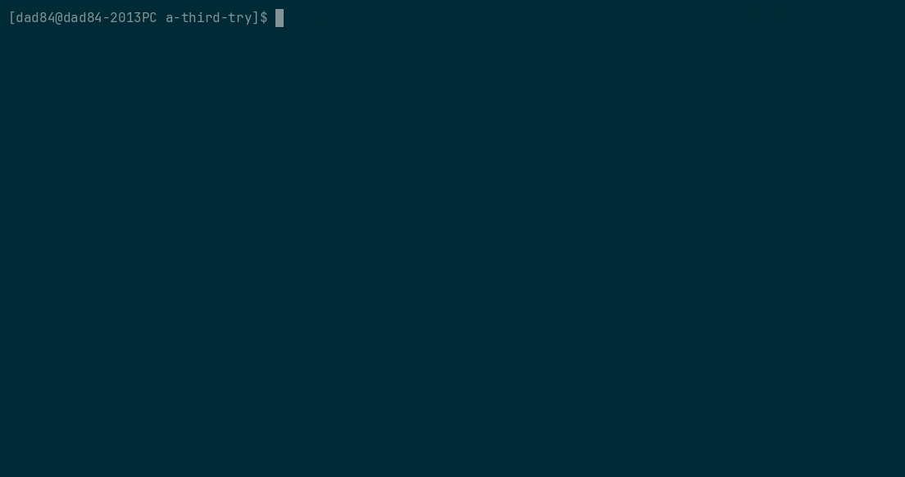
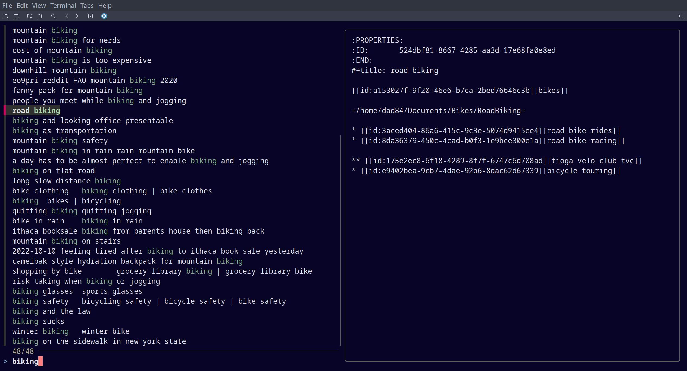
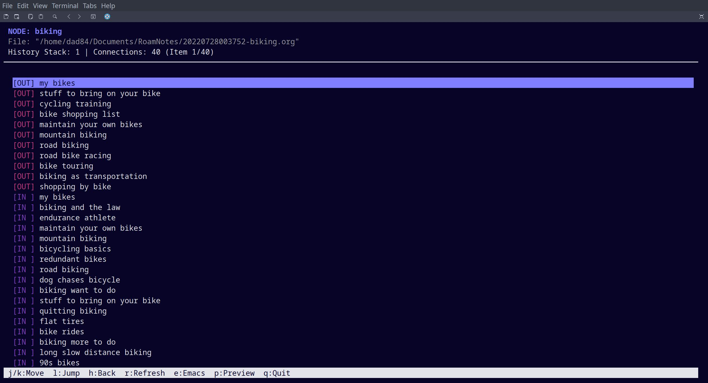
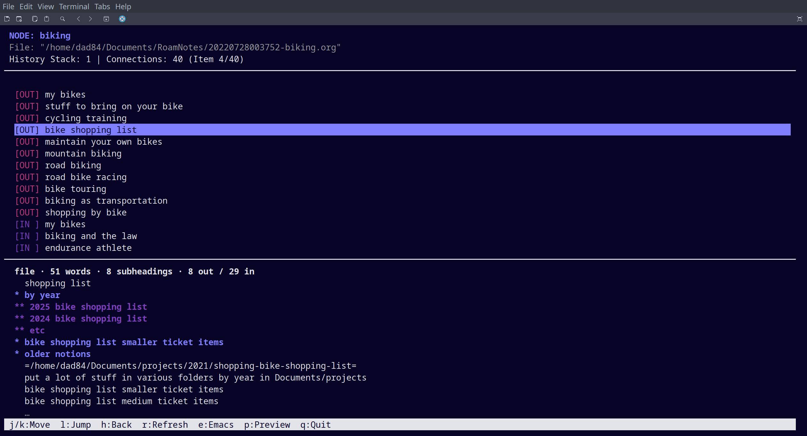

# org-roam-lynx

**A fast, keyboard-driven terminal browser for your Org-roam network.**

Move through your notes the way you move through directories in Midnight Commander or follow links in Lynx: pick a node, see everything it links to and everything that links back to it, press a key to jump, press another to go back. No browser, no server, no waiting.

In this GIF, we are roaming slowly so you can see what is going on.  Node preview is being turned on and off.
<p align="center">
  
</p>

Choose a starting node via the shell script:


Roam around your org roam node network (preview turned off):


Roam around your org roam node network (preview turned on):


Please note: this is designed for use with an Emacs session running
(e.g. GUI Emacs running in another PC monitor).  The GIF doesn't show
how we can hit the "e" key and visit a node in Emacs.

## Why?

If you use Org-roam, you've probably tried [org-roam-ui](https://github.com/org-roam/org-roam-ui). The graph is beautiful, but it's a web app: it starts a server, opens a browser, and draws a force-directed graph that gets harder to read as your notes grow. It's great for admiring the shape of your network and less great for quickly getting somewhere in it.

org-roam-lynx takes a different approach:

- **Lightweight.** It's a single Python script that reads Org-roam's SQLite database directly. It uses only the Python standard library, and each keypress runs a small query.
- **Keyboard-first.** Everything is one keystroke, with vi-style keys and arrow keys both supported.
- **Link-centric, not graph-centric.** You always see one node and its direct neighbors, split into outgoing links and backlinks. That is usually what you want when you're thinking "where does this lead?"
- **Plays well with Emacs.** Found the node you were looking for? Press `e` and it opens in your running Emacs. The browser stays open so you can keep exploring.

It's not a replacement for org-roam-ui's big-picture view. It's the fast lane for when you just want to get around.

## Features

- Browse any node's **outgoing links** and **backlinks** in one list
- **Jump** into a linked node, and **go back** through your history
- **Preview pane** for the highlighted connection, with Org-aware styling: property drawers and `#+` keywords hidden, headings colored by level, long sections collapsed
- **Stats line** per node: word count, subheading count, and how many links go out and come in. Nodes with very little content are flagged as **stubs**, so you can tell at a glance whether a node is worth opening
- **Open in Emacs** via `emacsclient` without leaving the browser
- **Refresh** after you've edited in Emacs, with your selection preserved
- **Fuzzy search front end** that searches titles and aliases with fzf, sorts by most recently modified, and hands the chosen node to the browser **by ID**, so duplicate or overlapping titles are never ambiguous
- **Read-only**: the database is opened in read-only mode, so it can't interfere with Emacs

## Requirements

- Python 3.9+ (uses only the standard library: `curses`, `sqlite3`)
- Org-roam v2 with a populated database
- For the search front end: `bash`, [`fzf`](https://github.com/junegunn/fzf), and the `sqlite3` command-line tool
- For the `e` key: a running Emacs server (`M-x server-start`, or `(server-start)` in your init file) and `emacsclient` on your `PATH`
- Linux or macOS (Windows lacks Python's `curses` by default)

## Installation

```bash
git clone https://github.com/cashTangoTangoCash/org-roam-lynx.git
cd org-roam-lynx

# Put the files somewhere on your PATH
install -m 755 org_roam_lynx_browse_graph.py ~/.local/bin/
install -m 755 org-roam-lynx-find-starting-node-then-browse-graph.sh ~/.local/bin/
```

Make sure `~/.local/bin` is on your `PATH`. The script names are long on purpose (they say what they do), so a short alias is handy. Add something like this to your shell config:

```bash
alias roam='org-roam-lynx-find-starting-node-then-browse-graph.sh'
```

If you keep the Python script somewhere other than `~/.local/bin`, point the launcher at it:

```bash
export ROAM_LYNX_PY=/path/to/org_roam_lynx_browse_graph.py
```

## Usage

### Search, then browse

```bash
org-roam-lynx-find-starting-node-then-browse-graph.sh              # fzf over all nodes, most recently modified first
org-roam-lynx-find-starting-node-then-browse-graph.sh bike         # pre-filtered to titles and aliases matching "bike"
org-roam-lynx-find-starting-node-then-browse-graph.sh "bike shop"  # put a phrase in double quotes
org-roam-lynx-find-starting-node-then-browse-graph.sh --help       # brief help
```

If exactly one node matches, you go straight into the browser. Otherwise fzf lets you pick one, with a live file preview alongside.

### Browse directly

```bash
python3 org_roam_lynx_browse_graph.py "Some node title"        # by title
python3 org_roam_lynx_browse_graph.py --id <org-roam-id>       # by ID
python3 org_roam_lynx_browse_graph.py --db /path/to/org-roam.db "Some node title"
```

A title is matched exactly if possible, otherwise as a substring. `--id` is unambiguous and overrides the title. With no arguments, the script starts at the node named in `START_NODE_TITLE` near the top of the file; edit that to whatever you like.

## Configuration

The database location is resolved in this order, by both the shell launcher and the Python script:

1. `--db PATH` (Python script only; the launcher passes its resolved path this way)
2. the `ORG_ROAM_DB` environment variable
3. `$XDG_CONFIG_HOME/emacs/org-roam.db` (default `~/.config/emacs/org-roam.db`)
4. `~/.emacs.d/org-roam.db`

If your `org-roam-db-location` is customized, or you use a distribution such as Doom Emacs that keeps the database under a cache directory, set it once in your shell profile:

```bash
export ORG_ROAM_DB="$HOME/path/to/org-roam.db"
```

| Variable | Purpose |
| --- | --- |
| `ORG_ROAM_DB` | Path to `org-roam.db` |
| `ROAM_LYNX_PY` | Path to `org_roam_lynx_browse_graph.py` (used by the launcher) |

## Keys

| Key | Action |
| --- | --- |
| `j` / `k`, `↓` / `↑` | Move the selection |
| `PgDn` / `PgUp`, `Space`, `Ctrl-f` / `Ctrl-b` | Page down / up |
| `l`, `→`, `Enter` | Jump to the highlighted node |
| `h`, `←`, `Backspace` | Go back |
| `e` | Open the **current** node in Emacs |
| `r` | Refresh from the database |
| `p` | Toggle the preview pane |
| `q` | Quit |

In the list, `[OUT]` entries are links from the current node and `[IN ]` entries are backlinks to it.

## How it works

Org-roam keeps an index of your notes in a SQLite database. org-roam-lynx queries the `nodes` and `links` tables for the current node's neighbors, and reads the node's file from disk for the preview (cached by file modification time, so revisiting is free). Opening in Emacs calls `org-roam-node-visit` through `emacsclient --eval`, which lands on the right heading even for nodes that aren't whole files.

Because it reads the database rather than your files, it's only as current as Org-roam's index. Save in Emacs (with `org-roam-db-autosync-mode` on) and press `r` to see changes.

## Known limitations

- Only `id:` links are followed, which are the links Org-roam itself tracks. Plain URLs and file links aren't shown as connections.
- The preview is a lightweight approximation of Org's appearance, not a full renderer.
- Heading-level nodes assume UTF-8 files with LF line endings when locating their text.
- In the fzf front end, double-quote characters are stripped from displayed titles (the browser itself shows them correctly, since it looks nodes up by ID).

## Roadmap ideas

- Open the *highlighted* node in Emacs (for example on `E`)
- Live auto-refresh when the database changes
- Tag display and filtering

## Contributing

This is a personal project that I share in case it’s useful. I may not respond to issues or pull requests, and I make no promises about support. Feel free to fork it.

## How it was Developed

This script was built through an iterative dialogue with Gemini (free
version) and Claude (free version). For a detailed look at the logic,
the alternative approaches considered, and the evolution of the code,
check the contents of the chat/ folder in this repository.

## License

See LICENSE file

## Acknowledgments

Inspired by the file-browsing feel of [Midnight Commander](https://midnight-commander.org/) and the link-following style of [Lynx](https://lynx.invisible-island.net/), and built on the excellent [Org-roam](https://www.orgroam.com/). Also see [org-roam-ui](https://github.com/org-roam/org-roam-ui) for a graphical alternative.
